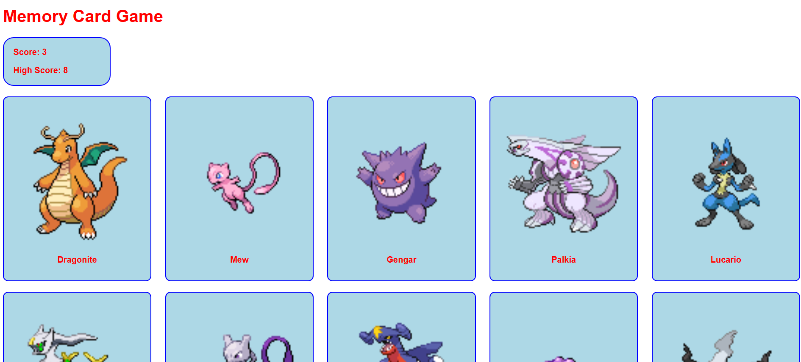

# Memory Card

A Pokémon memory game built with React. Click each card only once: every new card adds a point, and clicking a card twice resets your score. The cards shuffle after every click.

**Live demo:** https://memory-card-jasonbetsargon.vercel.app/



## Features
- Fetches 12 Pokémon from [PokéAPI](https://pokeapi.co/) on load
- Tracks current score and best score
- Shuffles the cards on load and after every click (Fisher–Yates)
- Loading and error states for the API request
- Responsive layout

## Built with
- React 19 (hooks: `useState`, `useEffect`)
- Vite
- CSS (Flexbox)
- Deployed on Vercel

## What I learned
- Using state in a parent component to pass down props to children
- Making API calls in ```useEffect``` to render when data is received
- Using ```Promise.all()``` when waiting for responses after making a batch of API calls 
- Implementing ```try() catch() finally()``` when making API calls

## Future improvements
- A new set of Pokémon after you click all 12
- Difficulty levels (8 / 12 / 16 cards)

## Getting started
```npm install```
```npm run dev```

Built as part of [The Odin Project](https://www.theodinproject.com/lessons/node-path-react-new-memory-card) curriculum.